# Electricity Consumption Forecasting — Azure End-to-End ML Pipeline

> **Projet individuel | 23–27 novembre 2026 | Livraison : vendredi 27/11/2026 avant 17h00 (heure de Casablanca)**
>
> Domaine : prévision de consommation électrique ; stack : Python, Pandas, Scikit-learn, Azure Data Factory, Azure Data Lake Storage Gen2 et Azure Machine Learning Designer.

## 1. Contexte et objectif

Dans un scénario fintech, ce projet vise à construire un pipeline de données et de Machine Learning, de l'ingestion CSV jusqu'à l'inférence, pour **prédire la consommation électrique horaire**. Il couvre une expérimentation locale de référence (Phase 1) puis sa reproduction dans Microsoft Azure (Phase 2). La conformité au RGPD, l'auditabilité et la reproductibilité sont des exigences transversales.

**Limite de connaissance :** le fichier CSV n'a pas encore été fourni. Le nom réel de la variable cible, les unités (kWh, kW), la période couverte, le fuseau des horodatages et la fréquence doivent être **confirmés sur le dataset**. Cette documentation ne présuppose aucun résultat numérique.

### Critères de réussite

- Données importées et validées depuis ADF vers `raw/YYYY/MM/DD/` sur ADLS Gen2 sans modification des originaux.
- Données horaires nettoyées, ordonnées, auditées ; doublons, trous horaires et valeurs aberrantes documentés.
- Variables calendaires et `lag24`, `lag168`, `roll_24` **causales** construites.
- Split chronologique **80 % train / 20 % test**, sans shuffle ni transformation apprise sur le test.
- **LinearRegression** et baseline `lag24` comparées sur **les mêmes observations** avec MAE, RMSE, R², MAPE et figures résiduelles.
- Pipeline Azure ML Designer exécuté ; data asset, compute, modèle versionné, scoring et pipeline d'inférence démontrés.
- Paramètres Azure, RGPD, autorisations, versions et preuves de fonctionnement vérifiables.

## 2. Architecture cible

```mermaid
flowchart LR
  S["CSV source"] --> ADF["Azure Data Factory: Copy Data"]
  ADF --> RAW["ADLS Gen2: raw/YYYY/MM/DD/"]
  RAW --> DS["Azure ML: Datastore + Data Asset"]
  DS --> PREP["Designer / Python: nettoyage + features"]
  PREP --> SPLIT["Split temporel: 80/20"]
  SPLIT --> TRAIN["Régression: Train Model"]
  TRAIN --> SCORE["Score + Evaluate"]
  SCORE --> REG["Model Registry: forecastingmodelv1"]
  REG --> INF["Inference Pipeline avec historique"]
```



**Délimitation :** `raw/` est une zone *immuable*. Les sorties nettoyées et les résultats peuvent être stockés localement et/ou dans `processed/` et `artifacts/` séparés de `raw/`. Les résultats d'entraînement ne doivent pas remplacer les fichiers sources.

## 3. Arborescence proposée

```text
.
├── README.md
├── jira_electricity_forecasting_azure_2026.csv
├── data/
│   ├── raw/                 # CSV local de développement (non commité si sensible)
│   └── processed/           # données transformées (générées)
├── notebooks/
│   ├── 01_discovery.ipynb
│   ├── 02_eda.ipynb
│   └── 03_modeling.ipynb
├── src/
│   └── electricity_forecasting/
│       ├── ingestion.py
│       ├── cleaning.py
│       ├── features.py
│       ├── train.py
│       ├── evaluate.py
│       └── inference.py
├── tests/
│   ├── test_features.py
│   └── test_time_split.py
├── azure/
│   ├── adf/                 # exports du pipeline et paramètres, sans secrets
│   └── aml/                 # exports, configurations et captures du Designer
├── reports/
│   ├── figures/
│   ├── metrics/
│   └── evidence/
└── artifacts/                # modèle joblib, version de données, métadonnées
```

> Cette arborescence est **proposée**, pas encore créée. Le présent livrable fournit uniquement le README et le CSV Jira.

## 4. Démarrage local (Phase 1)

### Prérequis

- Python 3.11 ou 3.12, Git et un environnement virtuel.
- Dépendances prévues : `pandas`, `numpy`, `scikit-learn`, `matplotlib`, `seaborn`, `joblib`, `jupyter`.
- Un fichier CSV avec une colonne `Datetime` et une colonne numérique de consommation à identifier.

Exemple de préparation avec `uv` :

```bash
uv venv
uv pip install pandas numpy scikit-learn matplotlib seaborn joblib jupyter
```

Puis déposer le CSV dans `data/raw/`, ne pas le commiter s'il contient des informations sensibles et renseigner son chemin dans le notebook ou le script. Un fichier `pyproject.toml` avec dépendances épinglées sera ajouté lors de l'implémentation pour garantir la reproductibilité.

### Étape 1 — Chargement et découverte

1. Lire le CSV avec Pandas.
2. Faire `pd.to_datetime(df["Datetime"], errors="coerce")` et examiner les dates non parsées.
3. Contrôler noms de colonnes, `dtypes`, `shape`, `describe()`, valeurs manquantes et période couverte.
4. Identifier la colonne cible réelle et vérifier qu'elle mesure une consommation comparable dans le temps.
5. Contrôler la fréquence horaire, le fuseau, les heures dupliquées et les trous temporels.

### Étape 2 — Nettoyage

- Détecter doublons complets et timestamps dupliqués ; ne dédupliquer qu'après identification de leur signification.
- Identifier valeurs manquantes, consommations négatives, zéros et pics ; distinguer erreur et vraie pointe.
- Justifier chaque suppression/imputation. Une interpolation utilisant des valeurs futures n'est pas admissible comme feature à l'instant de prévision.
- Trier par `Datetime` et conserver les comptes de lignes avant/après.
- Pour les lags, **valider/constituer une grille horaire régulière** en traitant explicitement les changements d'heure ; sinon `shift(24)` signifie 24 lignes et non nécessairement 24 heures.

### Étape 3 — EDA

- Série temporelle et zooms pertinents ; comparaison heure de la journée, jour de la semaine et mois.
- Graphiques enregistrés dans `reports/figures/` avec titres, axes et unités.
- Compte rendu sur tendance, saisonnalités, ruptures, pics et couverture de la série.

### Étape 4 — Feature engineering

Créer : `Hour`, `DayOfWeek`, `Month`, `Year`, `IsWeekend` ; côté Designer, compléter si utile par `Quarter` et `DayOfYear`.

Pour une prévision **une heure / une ligne à la fois**, avec `target` comme consommation mesurée :

```python
# Après validation de la grille horaire et tri chronologique.
df["lag24"] = df["target"].shift(24)
df["lag168"] = df["target"].shift(168)
df["roll_24"] = df["target"].shift(1).rolling(24).mean()
```

`target` est ici un **placeholder**, à remplacer par le nom réel de la colonne. `shift(1)` sur la moyenne glissante est essentiel : la consommation à prédire à t ne peut pas servir à la feature de t. Pour l'inférence, conserver l'historique suffisant et définir clairement la cible temporelle (t, t+1, ou autre horizon). Les variables catégorielles, si utilisées comme catégories, peuvent être encodées dans un pipeline fit sur train uniquement.

### Étape 5 — Préparation pour l'apprentissage

- Définir `y` (consommation) et `X` (features exclusivement connues à l'instant prédit).
- Écarter les premières observations sans historique ; répercuter **le même masque de lignes** aux deux modèles.
- Split chronologique 80/20 **après tri** et sans permutation :

```python
cut = int(len(df) * 0.80)
train, test = df.iloc[:cut], df.iloc[cut:]
assert train["Datetime"].max() < test["Datetime"].min()
```

- Faire `fit` des éventuels imputers/scalers/encodeurs **sur train seulement** ; appliquer `transform` à test.
- Conserver `date_min_train`, `date_max_train`, `date_min_test`, `date_max_test`, cardinalités et version du fichier.

### Étape 6 — Modèle, baseline et métriques

- **Baseline :** `prediction_t = lag24_t`.
- **Modèle :** `sklearn.linear_model.LinearRegression` (avec transformations encapsulées dans `Pipeline` / `ColumnTransformer` si besoin).
- Évaluer les deux **sur exactement les mêmes timestamps de test**.

| Métrique | Interprétation | Attention |
|---|---|---|
| MAE | Erreur absolue moyenne | Unité de la cible |
| RMSE | Racine de l'erreur quadratique moyenne | Sensible aux grandes erreurs |
| R² | Part de variabilité expliquée par rapport à une moyenne | Peut être négatif sur test |
| MAPE | Erreur absolue moyenne relative en % | Indéfinie mathématiquement si `y_true = 0` ; documenter une stratégie ou reporter une métrique alternative |

Comparer les résultats dans `reports/metrics/model_comparison.csv`, tracer réel vs prédit, résidus dans le temps, histogramme des erreurs et analyser les jours/heures atypiques. **Aucun seuil de performance n'est imposé dans le sujet** : la conclusion doit rapporter les métriques réelles, notamment si le modèle est moins bon que la baseline.

## 5. Déploiement sur Microsoft Azure (Phase 2)

### Ressources imposées

| Ressource | Configuration attendue |
|---|---|
| Région | **North Europe** |
| Azure Data Factory | Pipeline `Copy Data` pour CSV |
| ADLS Gen2 | Hierarchical namespace activé ; arborescence `raw/YYYY/MM/DD/` |
| Azure ML | Workspace + datastore ADLS Gen2 + data asset CSV |
| Azure ML Compute | CPU, **Standard_DS11_v2**, **2 vCPU / 14 GiB RAM**, min **0**, max **1**, autoscaling |
| Azure ML Designer | Pipeline de préparation / entraînement / évaluation / inférence |
| Azure ML SDK | **Bonus**, v2 `azure-ai-ml` si implémenté |

**Risque de disponibilité :** Microsoft classe désormais la famille DSv2 parmi les séries ayant une annonce de retrait. La taille exacte `Standard_DS11_v2` est néanmoins celle du cahier des charges. Vérifier sa disponibilité et les quotas dans **North Europe**, conserver une capture ; ne changer de taille qu'avec accord pédagogique et documenter tout écart.

### Séquence d'implémentation

1. **ADF — Ingestion :** créer factory, linked services source et ADLS, datasets CSV, activité `Copy Data`, exécution et vérification du run.
2. **Data Lake :** enregistrer les octets source sous `raw/YYYY/MM/DD/` (date d'ingestion) et préserver les fichiers originaux ; conserver horodatage et identifiant d'exécution.
3. **Azure ML :** workspace en North Europe ; datastore sur ADLS ; cluster CPU avec bornes 0 et 1 ; data asset versionné sur les fichiers raw.
4. **Designer — Canvas :** brancher l'asset ; `Summarize Data`, `Clean Missing Data` si pertinent, `Remove Duplicate Rows`, `Edit Metadata`, `Execute Python Script` pour features.
5. **Sélection et split :** `Select Columns in Dataset` ; `Split Data` 80/20. Désactiver toute randomisation **ne suffit que si l'ordre en entrée est réellement conservé** ; la séparation par **condition de date** (`Relative Expression`) ou une séparation déterministe contrôlée via Python peut être plus sûre. Vérifier les bornes des deux sorties.
6. **Entraînement :** algorithme de régression compatible, `Train Model`, `Score Model`, puis `Evaluate Model` ; ajouter un calcul explicite des métriques non fournies par le module.
7. **Modèle :** enregistrer `forecastingmodelv1` avec métadonnées de provenance (version asset, run ID, métriques, features).
8. **Inférence :** suivre, **si disponible dans la version Designer utilisée**, `Create inference pipeline` → `Real-time inference pipeline` ; supprimer les composants training/evaluation et conserver entrée, transformations, `Score Model` et sortie. Tester sur des données inédites avec historique.

### ⚠ Compatibilité Designer classique / Designer v2

Le sujet mentionne les **composants préconstruits classiques** de Designer et la commande de création d'un pipeline d'inférence temps réel. Ils restent documentés, mais **les composants classiques (v1) ne peuvent pas être combinés aux composants custom (v2)** et **ne se déploient pas directement sur les Managed Online Endpoints v2**. Un pipeline d'inférence classique n'est donc **pas synonyme** d'un endpoint managé v2. Pour la mise en production moderne : reconditionner le prétraitement et le modèle en composant / scoring script compatible v2, si requis et autorisé. L'exigence minimale ici est de **démontrer le pipeline d'inférence demandé** et de déclarer honnêtement la compatibilité réelle.

### Ingestion, orchestration et audit

L'orchestration minimale exigée est la copie par ADF et un job Azure ML reproductible. Une orchestration complète *ADF → job Azure ML* est possible selon les droits et le temps disponibles, mais **une liaison automatique opérationnelle entre ADF et Azure ML n'est pas supposée** tant qu'elle n'a pas été configurée et testée. Pour chaque run : stocker source, destination, date, run ID, statut, versions de données et modèle.

## 6. Sécurité, confidentialité et RGPD

- **Qualification des données :** des consommations agrégées peuvent ne pas identifier de personnes, mais un suivi fin de foyers/compteurs peut devenir une donnée personnelle. Documenter finalité, base légale applicable et minimisation selon le jeu effectivement reçu.
- **Accès :** Microsoft Entra ID / managed identities lorsque possible, Azure RBAC au moindre privilège, secrets dans un coffre approprié, aucun token ou mot de passe dans Git/captures.
- **Protection :** chiffrement en transit (TLS) et au repos, maîtrise de l'accès réseau et journalisation des opérations sensibles.
- **Rétention :** définir une période de conservation et les règles d'effacement si données personnelles ; éviter les copies incontrôlées dans notebooks/artefacts.
- **Localisation :** créer les ressources demandées en North Europe ; vérifier également les traitements, sauvegardes et éventuels transferts selon la politique applicable. Une région UE ne garantit pas à elle seule la conformité RGPD.
- **Traçabilité :** conserver choix de nettoyage, versions d'assets/modèles, logs ADF/AML, métriques et captures non sensibles.

## 7. Qualité, tests et définition de terminé

- **Qualité :** schéma de CSV conforme, dates parseables, contrôles sur duplications, négatifs, manque de lignes et monotonie temporelle.
- **Fuites de données :** features calculées uniquement depuis le passé et aucun `fit` de préprocesseur sur test.
- **Comparabilité :** baseline et régression évaluées sur dates identiques.
- **Infrastructure :** région, taille VM, min/max nodes, autoscaling, data asset et run enregistrés.
- **Inférence :** sortie de scoring testée, contrat de données et besoin d'historique documentés.
- **Audit :** pas de secrets versionnés ; preuves des runs, métriques et limites accessibles.

## 8. Planning de livraison (5 jours ouvrés)

| Jour | Priorité de réalisation | Jalon attendu |
|---|---|---|
| **Lun 23/11** | Initialisation, découverte, audit et politique RGPD initiale | Données comprises ; structure prête |
| **Mar 24/11** | Nettoyage, EDA, lags et split chronologique | Dataset prêt pour l'entraînement |
| **Mer 25/11** | Baseline, régression, métriques + démarrage ADF/ADLS | Résultats locaux et ingestion configurée |
| **Jeu 26/11** | ADF, raw/, workspace, compute, datastore et Designer | Pipeline cloud exécutable |
| **Ven 27/11** | Train/Score/Evaluate, registry, inference, vérification RGPD, documentation et démo | **Dépôt finalisé idéalement à 16h30 ; échéance ferme avant 17h00** |

**Priorisation :** terminer les obligations **High** avant le bonus SDK **Low** ; garder une marge pour quotas Azure, permissions, exécutions et captures.

## 9. Gestion du projet avec Jira Cloud

Le fichier `jira_electricity_forecasting_azure_2026.csv` fournit la hiérarchie **Epic → Task → Sub-task**, les dates, les priorités, les labels et les descriptions avec critères d'acceptation. L'estimation en heures est incluse dans les descriptions pour ne pas dépendre d'un champ de time tracking facultatif. Les tickets sont **non assignés** : aucune adresse Atlassian personnelle n'est supposée.

### Import recommandé : nouveau projet/espace Jira Software (Kanban)

1. Dans Jira Cloud, accéder à **Create space / Create project → Import data → CSV** (ou **Settings → System → External System Import → CSV**, selon l'accès et l'interface). Pour conserver la hiérarchie à plusieurs niveaux, **ne pas utiliser l'import rapide « Create work items from CSV »**.
2. Choisir un **projet Jira Software Kanban**, avec les work types **Epic**, **Task** et **Sub-task** activés. Utiliser le CSV complet en UTF-8, séparateur **virgule**.
3. Mapper exactement les en-têtes de la table suivante. Dans le mapping des valeurs, associer les types/valeurs aux noms visibles dans votre Jira (les noms peuvent être localisés).
4. Régler le format des dates sur **`yyyy-MM-dd`** pour la colonne `Due date` dans l'assistant d'import ; si cette option n'est pas proposée, convertir les dates au format affiché dans l'assistant avant import.
5. Vérifier en **preview** qu'un Task enfant pointe sur un Epic et qu'une Sub-task pointe sur un Task ; contrôler au moins un élément par niveau avant de confirmer.

| En-tête dans le CSV | Champ cible dans Jira Cloud | Obligatoire ? |
|---|---|---|
| `Work item ID` | **Work item ID** (ou `Issue ID` si interface historique) | Oui pour la hiérarchie |
| `Work type` | **Work type** / `Issue Type` | Oui pour la hiérarchie |
| `Summary` | **Summary** | **Toujours** |
| `Description` | **Description** | Recommandé |
| `Parent` | **Parent** | Oui pour les enfants |
| `Priority` | **Priority** | Recommandé, mapper High/Medium/Low |
| `Due date` | **Due date** | Recommandé, format `yyyy-MM-dd` |
| `Labels` | **Labels** | Recommandé |

**Note :** `Work item ID` et `Parent` sont des **identifiants temporaires internes d'import**, pas les clés définitives `PROJET-123`. Jira attribue les nouvelles clés après import. Les dépendances textuelles figurant dans les descriptions ne créent pas automatiquement des liens « Blocks ». Les Epics sont planifiés sur leur date de fin ; le détail de la journée est dans leurs Tasks / Sub-tasks. Aucune colonne non standard comme `Epic Link`, `Parent Link`, `Sprint` ou `Story Points` n'est requise pour cette importation. Selon le plan Jira et la configuration existante, les champs requis et types disponibles peuvent nécessiter une correspondance supplémentaire.

## 10. Livrables de soutenance

1. Code/notebooks Python avec EDA, cleaning, features, split et comparaison baseline/régression.
2. Fichier de résultats MAE, RMSE, R², MAPE ; courbe réel-prédit et analyse résiduelle.
3. Captures ou exports ADF Copy Data, Data Lake `raw/`, datastore, data asset et compute cluster.
4. Designer : canvas d'entraînement, sortie Evaluate, modèle enregistré `forecastingmodelv1`, canvas et test d'inférence.
5. README, notes RGPD et checklist end-to-end ; dépôt Git sans données ni identifiants sensibles.
6. (Bonus) script SDK Azure ML v2 documenté si les exigences obligatoires sont terminées.

## 11. Références officielles

- [Atlassian — Prepare a CSV file for import](https://support.atlassian.com/jira-software-cloud/docs/prepare-a-csv-file-for-import/)
- [Atlassian — Import data to a Jira Software project](https://support.atlassian.com/jira-software-cloud/docs/import-data-to-a-software-project-using-a-csv-file/)
- [Atlassian — Map CSV data to Jira fields](https://support.atlassian.com/jira-software-cloud/docs/mapping-csv-data-to-jira-fields/)
- [Azure ML — Designer v2](https://learn.microsoft.com/en-us/azure/machine-learning/concept-designer?view=azureml-api-2)
- [Azure ML — Split Data](https://learn.microsoft.com/en-us/azure/machine-learning/component-reference/split-data?view=azureml-api-2)
- [Azure ML — Classic component reference](https://learn.microsoft.com/en-us/azure/machine-learning/component-reference/component-reference?view=azureml-api-2)
- [Azure VMs — DSv2 family and lifecycle](https://learn.microsoft.com/en-us/azure/virtual-machines/sizes/memory-optimized/dv2-dsv2-series-memory)
- [Azure Data Factory — ADLS Gen2 connector](https://learn.microsoft.com/en-us/azure/data-factory/connector-azure-data-lake-storage)
- [Azure Data Factory — Security guidance](https://learn.microsoft.com/en-us/azure/data-factory/secure-your-azure-data-factory)

---

**Statut :** planification initiale, sans dataset ni ressources Azure encore vérifiés. Les métriques finales et captures seront renseignées après implémentation.
